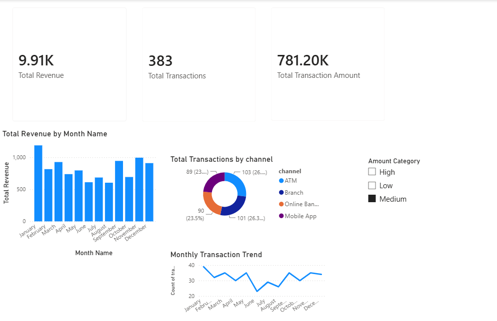

# Banking Data Analytics | SQL Server & Power BI

A university project where I built a **banking transaction analysis dashboard** using SQL Server and Power BI. The goal was to explore transaction activity, banking fee revenue, and customer channel usage.

## Tools
**SQL Server (T-SQL)** · **Power BI** · **Power Query** · **DAX**

## What I built
- A relational SQL Server database with six connected tables: `Customers`, `Accounts`, `Transactions`, `TransactionTypes`, `Branches`, and `Cards`.
- Synthetic sample data for **100 customers, 150 accounts, 120 cards, and 1,000 transactions**.
- Power Query transformations for customer names, dates, and transaction amount categories.
- DAX measures for transaction count, transaction amount, and fee revenue.
- An interactive Power BI dashboard showing monthly trends, banking channels, KPIs, and filters.

## Dashboard preview

*Preview with the **Medium** transaction amount filter selected.*

## Project files

- [Database creation script](01_create_database.sql)
- [Sample data generation script](02_insert_sample_data.sql)
- [Power BI Dashboard](Analize%20Transaksionesh.pbix)

## How to run
1. Run `01_create_database.sql` in SQL Server Management Studio.
2. Run `02_insert_sample_data.sql` **once** on the new database.
3. Open the `.pbix` file in Power BI Desktop. To refresh, update its SQL Server connection if needed.

**Note:** The SQL scripts were successfully tested in Microsoft SQL Server using a separate test database. All six tables were populated, including 1,000 transactions, and all five foreign key relationships were verified.
